# LoginFlowDesign

A modular Android login flow sample built with **Jetpack Compose**, **MVI**, **Hilt**, **Room + SQLCipher**, **Retrofit**, and **EncryptedSharedPreferences**. Demonstrates email/social login, biometric unlock, token refresh, encrypted local storage, and profile management.

**Demo API:** [DummyJSON](https://dummyjson.com/) (`emilys` / `emilyspass`)

---

## Screenshots

| Login | Biometric prompt |
|-------|------------------|
| 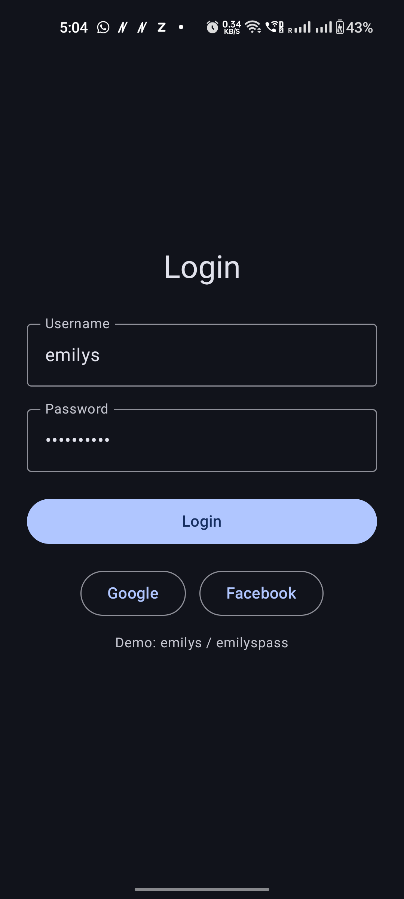 | 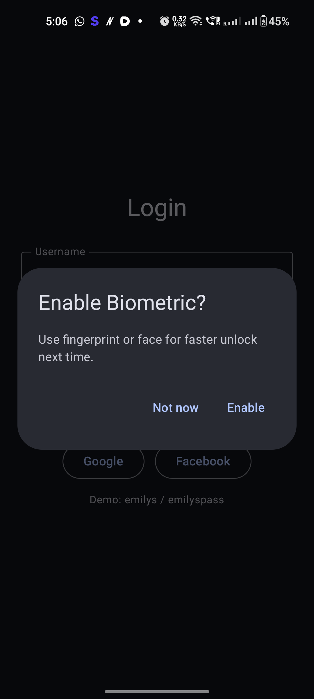 |

| Profile | Settings (debug) |
|---------|------------------|
| 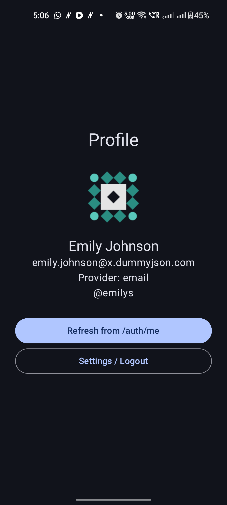 | 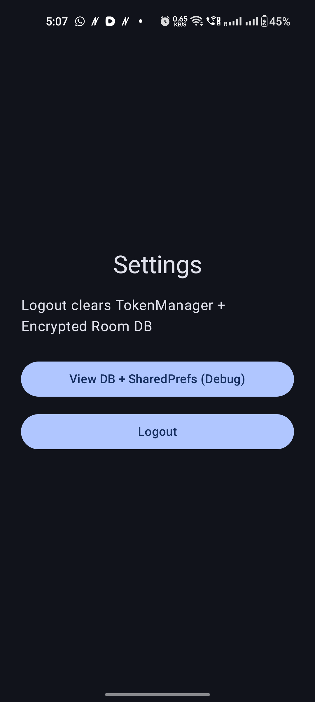 |

---

## Features

- Email/password login with token + refresh token persistence
- Google & Facebook sign-in (maps to demo API user after SDK auth)
- Biometric unlock on app launch (optional)
- Automatic token refresh via `AuthInterceptor` + `TokenAuthenticator`
- SQLCipher-encrypted Room database for user & session data
- EncryptedSharedPreferences for auth tokens
- MVI presentation layer in feature modules
- Debug data viewer (debug builds) for Room + prefs inspection

---

## Module Architecture

```
:app                 → NavHost, Splash, AppAuthNavigator, SocialSignInHelper
:feature-auth        → LoginScreen, BiometricScreen, LoginViewModel (MVI)
:feature-profile     → ProfileScreen, SettingsScreen, ProfileViewModel (MVI)
:core-auth           → AuthManager, AuthRepository, TokenManager, AuthApi
:core-network        → Retrofit, AuthInterceptor, TokenAuthenticator
:core-database       → SQLCipher Room, UserDao, SessionDao
```

### Dependency Graph

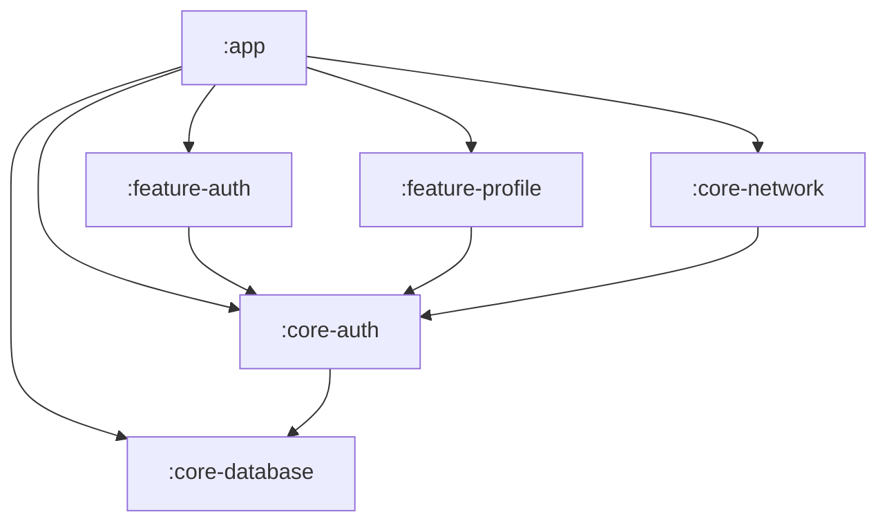

---

## High-Level Design (HLD)

### 1. System Context

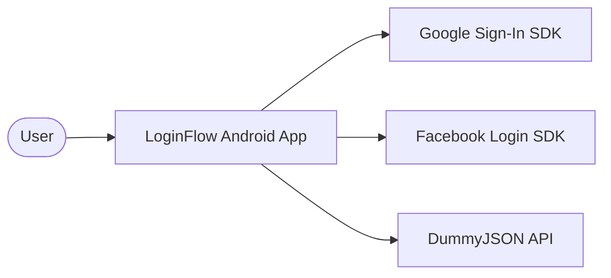

### 2. Layered Architecture

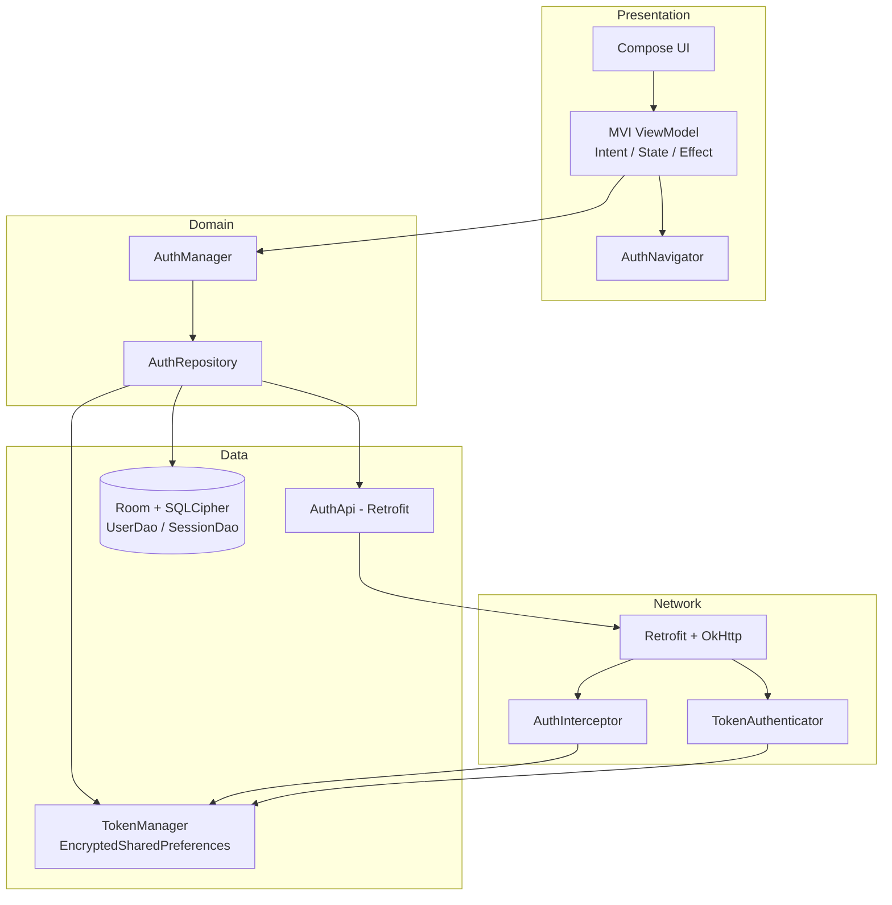

### 3. App Launch & Routing

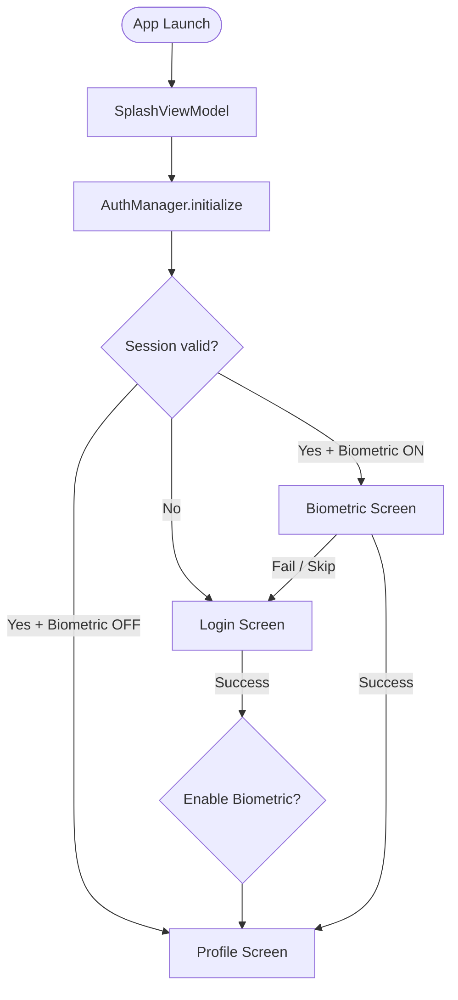

### 4. Login Sequence

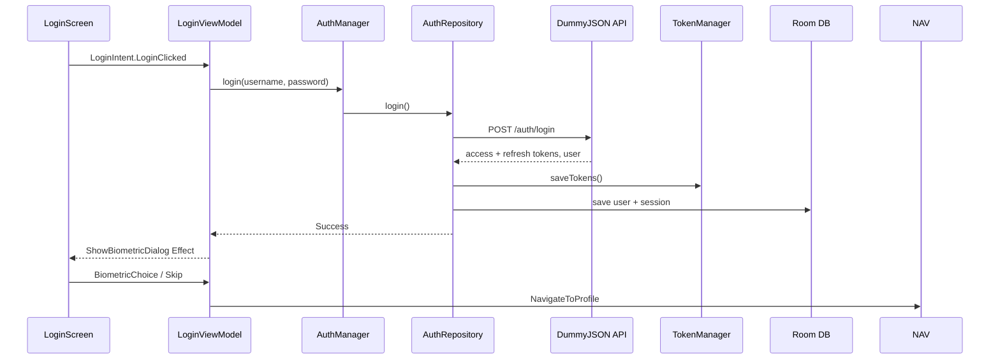

### 5. Authenticated API Call & Token Refresh

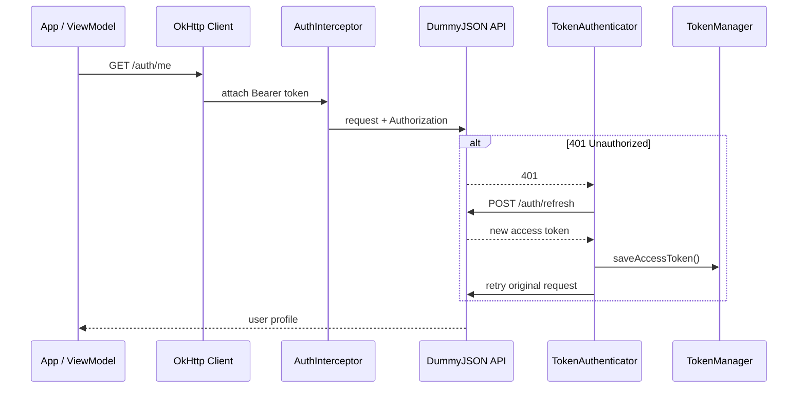

### 6. Local Storage Design

| Store | Technology | Contents |
|-------|------------|----------|
| `auth_tokens` | EncryptedSharedPreferences | access token, refresh token, expiry, biometric flag |
| `db_passphrase_prefs` | EncryptedSharedPreferences | SQLCipher passphrase |
| `login_flow_encrypted.db` | Room + SQLCipher | `users`, `sessions` tables |

### 7. MVI Flow (Feature Modules)

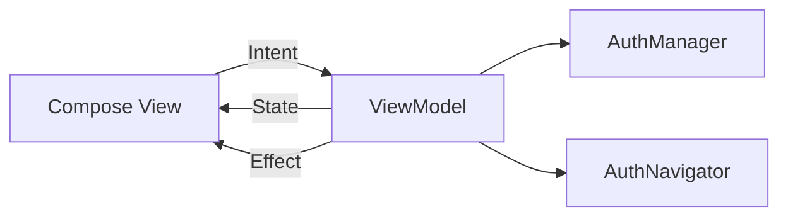

---

## Tech Stack

| Category | Libraries |
|----------|-----------|
| UI | Jetpack Compose, Material 3, Navigation Compose |
| Architecture | MVI, Hilt, ViewModel |
| Network | Retrofit, OkHttp, Gson |
| Database | Room, SQLCipher |
| Security | EncryptedSharedPreferences, Biometric API |
| Social | Google Play Services Auth, Facebook Login |

---

## Getting Started

### Prerequisites

- Android Studio Ladybug or newer
- JDK 17+
- Android SDK 35

### Run

1. Clone the repository
2. Open in Android Studio
3. Sync Gradle
4. Run on emulator or device (debug build)

### Demo credentials

```
Username: emilys
Password: emilyspass
```

### Facebook / Google

Replace placeholder values in `app/src/main/res/values/strings.xml`:

- `facebook_app_id`
- `facebook_client_token`

Configure Google Sign-In in [Google Cloud Console](https://console.cloud.google.com/) for your app package `com.example.loginflow`.

---

## Debug Data Viewer

In **debug builds**, open **Profile → Settings → View DB + SharedPrefs (Debug)** to inspect:

- Room `users` and `sessions` tables
- EncryptedSharedPreferences token snapshot (masked)

> Android Studio App Inspection cannot read SQLCipher or EncryptedSharedPreferences directly.

---

## Project Structure

```
LoginFlowSystemDesign/
├── app/                    # Application shell, NavHost, social sign-in
├── feature-auth/           # Login + Biometric (MVI)
├── feature-profile/        # Profile + Settings (MVI)
├── core-auth/              # Auth domain, repository, tokens
├── core-network/           # Retrofit, interceptors
├── core-database/          # Encrypted Room database
└── docs/screenshots/       # README screenshots
```

---

## License

This project is provided as a system design reference sample.
